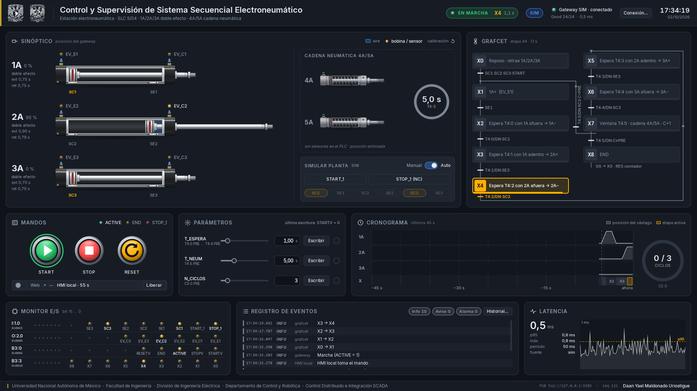
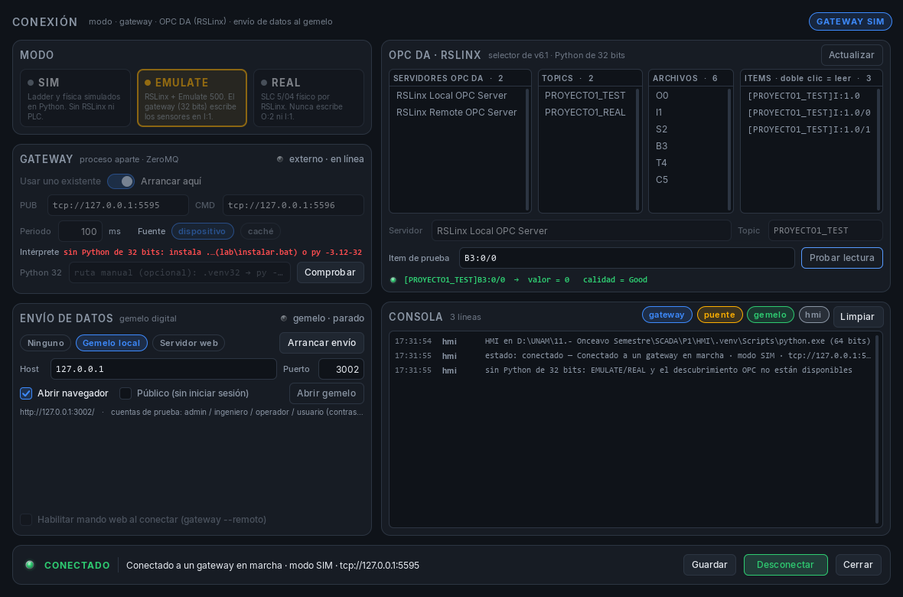
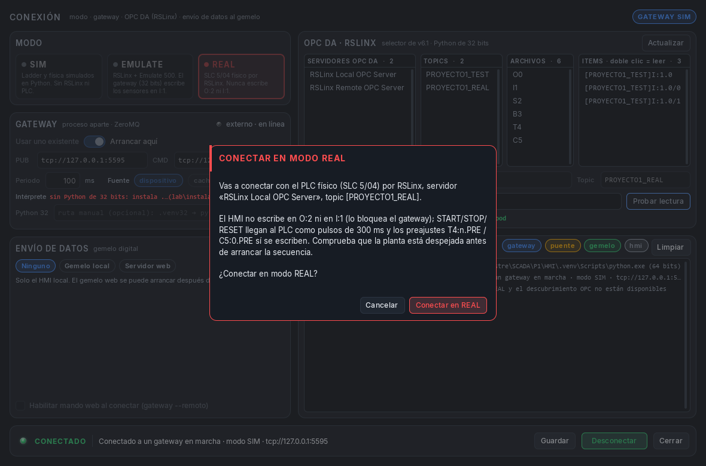
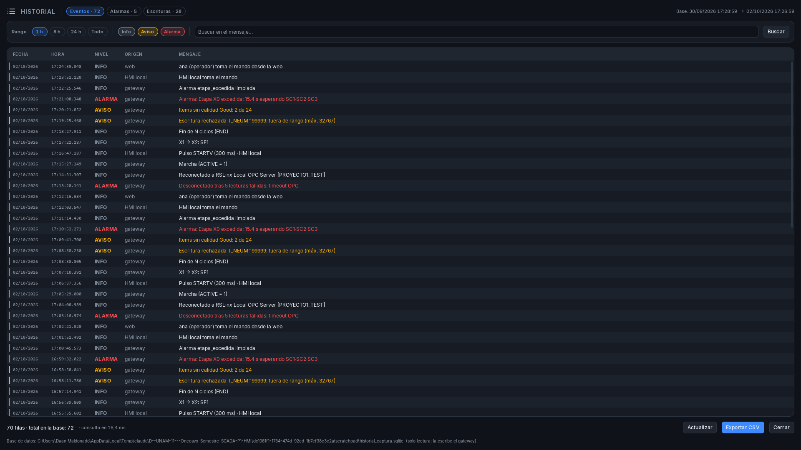

# Guía de instalación y prueba del HMI con el PLC

Estación electroneumática · SLC 5/04 · HMI en Python (PySide6 + QML) · OPC DA por RSLinx Classic

Esta guía explica, paso a paso, cómo **bajar el proyecto desde GitHub en otra computadora**, instalarlo, y **ejecutar el HMI contra el PLC real**, con el **gemelo digital apagado**. Está pensada para la PC del laboratorio (Windows 10/11) y para cualquier persona que reciba el repositorio sin haberlo visto antes. El PDF se genera desde este mismo archivo (`docs/generar_pdf.py`).

> **En una frase:** descargas el repositorio, instalas dos Python (uno de 32 bits para hablar con RSLinx y otro de 64 bits para la pantalla), ejecutas `lab\instalar.bat`, preparas RSLinx y, al final, abres el HMI con `lab\hmi.bat` y conectas en modo **REAL** desde su ventana de conexión.

> **Si algo falla con el PLC o va lento:** lee `docs\DIAGNOSTICO_CONEXION_PLC.md`. Es el informe de la prueba del 3 de octubre en el laboratorio: la ruta real de comunicación (RSLinx → 1761‑NET‑ENI → SLC), los cuatro problemas que se encontraron (direcciones inexistentes, órdenes que se daban por perdidas, lectura lenta, reintentos del enlace serie), los tiempos medidos y qué revisar en RSLogix y en el ENI. Esta guía ya incorpora sus conclusiones.

## 1. Qué es lo que vas a ejecutar

El HMI son **dos programas** que se hablan por la red local de la propia PC (ZeroMQ):

| Programa | Qué hace | Python | Cómo se arranca |
|---|---|---|---|
| **Gateway** (`gateway/`) | Lee y escribe el PLC por OPC DA (RSLinx). Publica el estado 10 veces por segundo y atiende las órdenes. Es el **único** que toca el PLC. | 3.12 de **32 bits** (OPC DA es COM de 32 bits) | Lo arranca el HMI desde su ventana de conexión, o `lab\gateway.bat` |
| **HMI** (`ui/`) | La pantalla: sinóptico de cilindros, GRAFCET, mandos, parámetros, cronograma, monitor de E/S, registro, latencia, ventana de conexión e historial. | 3.13 (o 3.12) de **64 bits** | `lab\hmi.bat` |

El **gemelo digital** (página web 3D, `digital_twin/`) es un tercer bloque **opcional**. En esta guía queda **apagado**: en la ventana de conexión, «Envío de datos» se deja en **Ninguno**. No hace falta internet ni cuentas.

Reglas de seguridad que el software aplica siempre en modo REAL: **nunca escribe las salidas `O:2`** (las manda el ladder), **nunca escribe las entradas `I:1`**, los mandos START / STOP / RESET son **pulsos de 300 ms** sobre `B3:0/0`, `B3:0/1` y `B3:0/4`, y solo acepta lecturas con calidad `Good`.

## 2. Descargar el proyecto desde GitHub

Repositorio: **https://github.com/DaanMaldonadoU/SCADA-Digital-Twin**

Elige **una** de las dos formas. Recomendación: una carpeta **corta, sin espacios ni acentos**, por ejemplo `C:\Proyectos\HMI` (los scripts funcionan con espacios, pero los comandos se escriben más fácil sin ellos).

### 2.1 Con Git (recomendado: permite actualizar con un solo comando)

1. Instala **Git para Windows** desde https://git-scm.com/download/win (siguiente, siguiente; las opciones por defecto sirven).
2. Abre una consola (**Símbolo del sistema** o **PowerShell**) y escribe:

```bat
mkdir C:\Proyectos
cd C:\Proyectos
git clone https://github.com/DaanMaldonadoU/SCADA-Digital-Twin.git HMI
cd HMI
```

3. Si el repositorio es **privado**, Git te pedirá iniciar sesión en GitHub la primera vez (se abre una ventana del navegador; con *Git Credential Manager* queda guardado). Si pide contraseña en texto, GitHub exige un **token** en lugar de la contraseña (GitHub → Settings → Developer settings → Personal access tokens).
4. Para **actualizar** más adelante a la última versión:

```bat
cd C:\Proyectos\HMI
git pull
```

### 2.2 Sin Git (archivo ZIP)

1. En la página del repositorio pulsa el botón verde **Code → Download ZIP**.
2. Descomprime el ZIP (clic derecho → *Extraer todo*). La carpeta se llamará `SCADA-Digital-Twin-main`; **renómbrala** a `HMI` y muévela a `C:\Proyectos\HMI`.
3. Para actualizar tendrás que repetir la descarga y copiar encima (conserva tu carpeta `datos\`, que guarda la configuración y la calibración).

### 2.3 Qué contiene la carpeta

| Carpeta / archivo | Para qué sirve |
|---|---|
| `lab\` | **Lanzadores de doble clic** para el laboratorio: `instalar.bat`, `probar_opc.bat`, `gateway.bat`, `hmi.bat`, `hmi_sim.bat`, `pruebas.bat`, `gemelo_local.bat`. |
| `ui\` | El HMI (PySide6 + QML). |
| `gateway\` | El gateway OPC / simulador, y el diagnóstico OPC (`diagnostico_opc.py`). |
| `core\` | Tabla de variables del PLC (`tags.py`), protocolo, calibración, alarmas, historial. |
| `assets\` | Gráficos de los cilindros, iconos, logotipos y fuentes. |
| `docs\` | Esta guía (Markdown y PDF) y su generador, y `DIAGNOSTICO_CONEXION_PLC.md` (informe de la prueba con el PLC del 3 de octubre: problemas, tiempos medidos y qué revisar). |
| `mds\` | Documentación técnica del proyecto (contexto, arquitectura, instalación en el laboratorio, enlace web). |
| `tests\` | Pruebas automáticas (no necesitan PLC). |
| `digital_twin\`, `puente\` | Gemelo digital web y su enlace. **No se usan en esta guía.** |
| `old\` | HMI v6.1 (Tkinter) que funcionaba con el PLC; referencia de respaldo. |
| `datos\` | Se crea sola al ejecutar: configuración de conexión, calibración de carreras, historial SQLite. No viene en el repositorio. |

## 3. Instalar Python (dos intérpretes)

Necesitas **dos** instalaciones de Python de https://www.python.org/downloads/windows/ :

| Intérprete | Instalador | Para qué | Al instalar, marcar |
|---|---|---|---|
| **Python 3.12 de 32 bits** | `python-3.12.x.exe` (el que **no** dice `amd64`; en la página, columna *Windows installer (32-bit)*) | Gateway OPC: RSLinx expone OPC DA como COM de 32 bits. | **Add python.exe to PATH** y **py launcher** (en *Customize installation* → *Optional Features*). |
| **Python 3.13 de 64 bits** (o 3.12 de 64 bits) | `python-3.13.x-amd64.exe` | HMI (PySide6 no publica versiones de 32 bits), pruebas. | **py launcher** (si ya lo instaló el anterior, déjalo marcado). |

Comprueba en una consola nueva (ábrela **después** de instalar):

```bat
py -3.12-32 -c "import sys; print(sys.version, sys.maxsize < 2**32)"
py -3.13-64 -c "import sys; print(sys.version, sys.maxsize > 2**32)"
```

Las dos líneas deben terminar en `True`. Si `py` no se reconoce, falta el **py launcher**: vuelve a ejecutar el instalador → *Modify* y márcalo.

## 4. Instalar las dependencias

Doble clic en **`lab\instalar.bat`** (o, desde una consola en `C:\Proyectos\HMI`, escribe `lab\instalar.bat`). Tarda unos minutos con internet. Hace esto, en orden:

1. Crea `.venv32` con Python 3.12 de 32 bits e instala `requirements-gateway.txt` (pyzmq, msgpack, loguru, pywin32, OpenOPC-Python3x).
2. Crea `.venv` con Python de 64 bits e instala `requirements-hmi.txt` (PySide6, pyzmq, msgpack, loguru, aiohttp) y pytest.
3. Comprueba que todo se importa.
4. Ejecuta las **pruebas automáticas** (`pytest`, ~1 minuto, sin PLC). Deben terminar con `passed` y **sin `failed`**. Si una prueba dice `skipped` por Playwright, es normal: es del gemelo y es opcional.

Si al final dice `AVISO: falta algo en .venv32 (OpenOPC o pywin32)`, ejecuta una vez:

```bat
.venv32\Scripts\python.exe .venv32\Scripts\pywin32_postinstall.py -install
```

### 4.1 Sin internet en el laboratorio

Descarga las ruedas en otra PC con internet (desde la raíz del repositorio, con cualquier Python 3.12/3.13):

```bat
py -3 -m pip download --platform win32 --python-version 3.12 --only-binary=:all: -d ruedas32 pyzmq msgpack loguru pywin32
py -3 -m pip download --no-binary=:all: --no-deps -d ruedas32 OpenOPC-Python3x
py -3 -m pip download --platform win_amd64 --python-version 3.13 --only-binary=:all: -d ruedas64 -r requirements-hmi.txt pytest
```

Copia `ruedas32\` y `ruedas64\` junto al repositorio y, en el laboratorio, instala con `--no-index --find-links`:

```bat
py -3.12-32 -m venv .venv32
.venv32\Scripts\python.exe -m pip install --no-index --find-links ruedas32 -r requirements-gateway.txt
py -3.13-64 -m venv .venv
.venv\Scripts\python.exe -m pip install --no-index --find-links ruedas64 -r requirements-hmi.txt pytest
```

## 5. Primera prueba: todo sin PLC (modo SIM)

Antes de tocar RSLinx comprueba que la pantalla funciona. Doble clic en **`lab\hmi_sim.bat`**: abre el HMI y un gateway **simulado** (ladder y física en Python). Debes ver el chip **SIM** azul en la cabecera, el LED de conexión verde, `Good 24/24` y el GRAFCET en **X0**.



Prueba: pulsa **START** (las etapas avanzan X1…X7, los cilindros se mueven, el cronograma se llena; a los 3 ciclos aparece «Fin de N ciclos (END)»), **STOP** (congela la etapa), **START** otra vez (continúa), **RESET** (vuelve a X0). Escribe `T_ESPERA = 0,50` s y pulsa **Escribir**: el círculo de la derecha se pone verde cuando el PLC simulado lo relee. Cierra la ventana: el gateway simulado se cierra solo.

Si la ventana sale **negra o se cierra al instante**, es el OpenGL de la PC. Abre una consola y arranca así:

```bat
set QT_OPENGL=software
set QT_QUICK_BACKEND=software
lab\hmi_sim.bat
```

## 6. Preparar RSLinx y OPC en la PC del laboratorio

Esto se hace **una sola vez** por PC. Requisitos y cómo comprobar cada uno:

| Elemento | Detalle | Cómo comprobarlo |
|---|---|---|
| **RSLinx Classic con OPC** | Edición Gateway, OEM o Single Node. **RSLinx Lite no tiene servidor OPC.** | En RSLinx existe el menú `DDE/OPC → Topic Configuration`. |
| **Driver hacia el PLC** | **En el laboratorio:** driver Ethernet **`AB_ETH-2`** apuntando al **1761‑NET‑ENI** en **192.168.1.80**; el ENI convierte a serie DF1 y entra por el **canal 0** del SLC (máximo 19 200 bps). Ya está configurado. **Alternativa** si el ENI no está: driver `RS‑232 DF1 devices → Add New`, puerto COM del cable 1747‑CP3 (o del adaptador USB‑serie) y **Auto‑Configure**; canal 0 del SLC a 19 200 bps, CRC. | `Communications → RSWho` muestra el `1747‑L541` bajo el driver (`AB_ETH-2` o el DF1). |
| **Topic `PROYECTO1_TEST`** | En el RSLinx del laboratorio **ya existe** y apunta al SLC real a través del ENI (no existe `PROYECTO1_REAL`; ese nombre de guías anteriores ya no se usa). Si montas otra PC, créalo con ese mismo nombre: `DDE/OPC → Topic Configuration → New`, `PROYECTO1_TEST`, en *Data Source* seleccionar el SLC dentro del driver, en *Data Collection* tipo de procesador **SLC 5/04**. *Polled Messages*: en el laboratorio estaba en **1000 ms**; prueba con **100 ms**. **Done / Apply**. | `DDE/OPC → OPC Test Client`: `Server → Connect → RSLinx OPC Server`, `Group → Add Group`, `Item → Add Item` con `[PROYECTO1_TEST]I:1.0`: calidad **Good**. |
| **OPC Core Components** | Los instala RSLinx. Si faltan, el *OPC Core Components Redistributable* **x86** de la OPC Foundation. | `lab\probar_opc.bat --servidores` lista `RSLinx OPC Server` y/o `RSLinx Local OPC Server` (en el laboratorio se usó `RSLinx OPC Server`; sirve cualquiera de los dos que aparezca). |
| **`gbda_aut.dll` registrada** | Es la DLL de OpenOPC. Tras el paso 4 está en `.venv32\Lib\site-packages\OpenOPC\lib\gbda_aut.dll`. Cópiala a `C:\Windows\SysWOW64\` y regístrala con el `regsvr32` **de 32 bits** desde una consola **como administrador**. | `lab\probar_opc.bat --servidores` no dice `Class not registered`. |
| **Ladder cargado y en RUN** | Programa del 18‑sep con los preajustes `T4:0…4.PRE = 100`, `T4:5.PRE = 500`, `C5:0.PRE = 3`. El archivo **B3 debe tener 4 palabras** (`B3:0…B3:3`) y el **T4, 6 temporizadores** (`T4:0…T4:5`): el 3 de octubre el PLC tenía otro programa (B3 de 1 palabra, T4 de 4 temporizadores, preajustes en 0) y el HMI no podía leer las etapas. | RSLogix 500 en línea, modo RUN; en el árbol del proyecto, *Data Files* muestra B3 y T4 con esos tamaños. |

Registro de la DLL (consola **como administrador**, desde la raíz del repositorio):

```bat
copy .venv32\Lib\site-packages\OpenOPC\lib\gbda_aut.dll C:\Windows\SysWOW64\
C:\Windows\SysWOW64\regsvr32.exe C:\Windows\SysWOW64\gbda_aut.dll
```

Debe aparecer «DllRegisterServer en … se realizó correctamente». Si se registra con el `regsvr32` de 64 bits (el de `System32`) no sirve.

## 7. Diagnóstico OPC desde el repositorio (antes del HMI)

Con RSLinx abierto y el SLC en RUN, doble clic o consola:

```bat
lab\probar_opc.bat --servidores
lab\probar_opc.bat --topics
lab\probar_opc.bat --topic PROYECTO1_TEST --modo REAL --n 30
```

- La primera debe listar `RSLinx OPC Server` o `RSLinx Local OPC Server`; la segunda, `PROYECTO1_TEST`.
- La tercera lee las cuatro palabras (`I:1.0`, `O:2.0`, `B3:0`, `B3:3`), los seis temporizadores y el contador, **30 veces desde el dispositivo y 30 desde la caché de RSLinx**, con valor, calidad y tiempos (mínimo / medio / p95 / máximo). Todo debe salir `Good`. **Anota los tiempos** y compáralos con los del 3 de octubre: caché 6–8 ms por lectura, dispositivo 200–2238 ms.
- Si `B3:3`, `T4:4` o `T4:5` salen `Bad` y arrastran a `B3:0` o a `T4:0…T4:3`, el PLC no tiene esos elementos: el programa descargado no es el de la tabla. RSLinx junta en un solo paquete los items del mismo archivo y, si uno no existe, el paquete entero vuelve `Bad`. Descarga el ladder correcto antes de seguir.

Después, la escritura de preajustes (reescribe `T4:0.PRE` con su mismo valor; no cambia nada en el PLC):

```bat
lab\probar_opc.bat --topic PROYECTO1_TEST --modo REAL --probar-preajustes --confirmar-real
```

Debe decir `OK, RSLinx acepta escribir PRE`. Si dice `FALLO`, anota la respuesta tal cual: el HMI escribe los parámetros con esa misma llamada.

## 8. Ejecutar el HMI con el PLC (gemelo digital apagado)

Doble clic en **`lab\hmi.bat`**. Como todavía no hay gateway, a los 2 segundos el HMI abre sola la **ventana de conexión** (también se abre con el botón **Conexión…** de la cabecera). Es el equivalente del selector de la v6.1: todo se hace desde ahí.



Sigue las secciones de la ventana en orden:

1. **Modo:** clic en la tarjeta **REAL** (se pone roja). *EMULATE* es para RSLogix Emulate 500; *SIM* no usa RSLinx. **Comprueba que de verdad quedó en REAL**: la ventana recuerda el último modo guardado y, en SIM, los botones del HMI mueven la planta simulada y **no llegan al PLC** (el 3 de octubre `datos\conexion.json` había quedado en SIM y START no hacía nada en el PLC).
2. **Gateway:** el interruptor en **Arrancar aquí**. La línea *Intérprete* debe mostrar la ruta de `.venv32\Scripts\python.exe` (si está en rojo, «sin Python de 32 bits», repite el paso 4 o escribe la ruta en *Python 32* y pulsa **Comprobar**). Periodo **100** ms, fuente **caché** (es la opción por defecto: lee lo que RSLinx ya trajo del PLC en 6–8 ms; *dispositivo* espera al PLC en cada lectura, 200–2238 ms medidos, y deja al gateway bloqueado). Los endpoints `tcp://127.0.0.1:5555` / `5556` se dejan como están.
3. **OPC DA · RSLinx:** pulsa **Actualizar** y usa las cuatro listas como en la v6.1: clic en el servidor (`RSLinx OPC Server` o `RSLinx Local OPC Server`, el que aparezca) → clic en `PROYECTO1_TEST` (la ventana ya lo propone también en REAL) → clic en un archivo (`I1`, `O2`, `B3`, `T4`…) → **doble clic en un item** para leerlo. La línea de estado muestra valor y calidad (**verde = Good**). También puedes escribir `B3:0/0` en *Item de prueba* y pulsar **Probar lectura**. Cada consulta ejecuta `gateway\diagnostico_opc.py` con el Python de 32 bits; su salida aparece en la consola de la ventana.
4. **Envío de datos:** **Ninguno**. Así el gemelo digital queda apagado: no se arranca ningún puente ni servidor web y no hace falta internet.
5. **Conectar.** En modo REAL aparece un diálogo rojo de confirmación: lee el texto y pulsa **Conectar en REAL**.



6. En la consola de la ventana verás el gateway arrancar: `OPC DA conectado a 'RSLinx OPC Server', topic [PROYECTO1_TEST], 22 items rápidos, fuente cache`. En el pie de la ventana: **CONECTADO · modo REAL**. En la pantalla principal: chip **REAL** en rojo, LED verde, `Good 24/24` y la etapa del GRAFCET que tenga el PLC.
   - Al conectar, el gateway **comprueba la tabla de direcciones** contra el PLC: lo que el PLC no tiene lo quita de la lectura y lo anuncia con una alarma, por ejemplo «El PLC no tiene B3:3, T4:4, T4:5…». Si la ves, o si la calidad dice `Good 17/17` en lugar de `Good 24/24`, **el programa descargado no es el de la tabla** (B3 con 4 palabras, T4 con 6 temporizadores, preajustes distintos de 0; `docs/TABLA_DE_VARIABLES.md` §3): descarga el ladder correcto y vuelve a conectar. Las escrituras a esos elementos se rechazan con «… no existe en el PLC».
7. Pulsa **Guardar** si quieres que la próxima vez solo tengas que abrir la ventana y pulsar **Conectar** (la configuración queda en `datos\conexion.json`). Puedes **cerrar** la ventana de conexión: el gateway sigue corriendo mientras el HMI esté abierto.

> **Las órdenes tardan en confirmarse.** Una escritura por el enlace serie del ENI tarda de 100 a 1200 ms, así que el HMI espera hasta **2 s** la respuesta de cada orden (antes eran 500 ms y daba por perdidas órdenes que el PLC sí recibía). En el laboratorio, un pulso de START se confirmó a los ~0,9 s y el bit se vio en pantalla a los ~1,0 s. Si aparece «sin respuesta del gateway en 2000 ms», el enlace está saturado: revisa el §9, punto 6.

> **Alternativa con dos consolas** (como se hacía antes): `lab\gateway.bat` (sin argumentos: REAL sobre `PROYECTO1_TEST`, fuente caché) en una consola y `lab\hmi.bat` en otra. Si abres la ventana de conexión con el gateway ya corriendo dirá «Conectado a un gateway en marcha» y conviene dejar el interruptor en **Usar uno existente**; no pulses «Arrancar aquí» (los puertos 5555/5556 ya están ocupados y el segundo gateway terminaría con error).

## 9. Lista de verificación con el PLC

Anota cada punto (sirve para la bitácora del proyecto):

1. **Sensores → pantalla.** Mueve un cilindro a mano o arranca la secuencia: los indicadores SC/SE del sinóptico y el monitor de E/S cambian. Los vástagos se animan con la duración **calibrada**: la primera carrera usa 0,8 s y «salta» al llegar el sensor; a partir de la segunda, `datos\calibracion.json` guarda el tiempo medido y la animación coincide con la máquina.
2. **Mandos.** **START** desde el HMI (pulso de 300 ms a `B3:0/0`): `ACTIVE` se enciende y la secuencia arranca. **STOP** congela la etapa; **START** continúa; **RESET** vuelve a X0. El pulsador físico de paro (NC) muestra el aviso «Stop físico» mientras está pulsado.
3. **Parámetros.** `T_ESPERA` escribe los cinco `T4:0…4.PRE`; el círculo verde aparece al releerlos. `T_NEUM` (`T4:5.PRE`) y `N_CICLOS` (`C5:0.PRE`) igual. Comprueba que el tiempo de cada etapa cambia de verdad en la máquina.
4. **Seguridad.** En REAL no existe el panel «Simular planta»; el gateway rechaza cualquier escritura a `I:1` y nunca escribe `O:2`.
5. **Desconexión.** Desenchufa el cable de red del ENI (o el cable DF1 si usas el driver serie): tras 5 lecturas fallidas aparece la alarma en la banda roja y el gateway reintenta (1, 2, 4, 8 s). Vuelve a enchufar: se reconecta solo y la alarma se normaliza.
6. **Latencia** (panel inferior derecho). Anota `lectura`, `p95`, `periodo` y `fuente`. Con la fuente **caché** (defecto) la lectura del gateway tarda 6–8 ms y publica unas 9 pantallas por segundo; el botón **caché / dispositivo** sirve para comparar, pero *dispositivo* deja al gateway esperando al PLC en cada lectura (200–2238 ms medidos). Mira además el retardo **real** sensor → pantalla (cuánto tarda un LED en cambiar cuando el cilindro llega al final).
7. **Fin de ciclos.** `END` dura un solo barrido del PLC: el HMI cuenta los fines por el paso X7 → X0 y lo anuncia en el registro de eventos.

**Valores de referencia medidos el 3 de octubre** (detalle en `docs\DIAGNOSTICO_CONEXION_PLC.md` §5–§6):

| Medida | Valor |
|---|---|
| Lectura del gateway desde la caché | 6–8 ms |
| Lectura del gateway desde el dispositivo | 200–2238 ms |
| Refresco real de la caché de RSLinx (update 100 ms) | mediana ~300–400 ms, p90 ~1,3 s |
| Refresco con update 20 ms | **peor**: mediana ~1,2–1,4 s (el enlace se satura) |
| Escritura de un bit | 100–1200 ms |
| Ping de la PC al ENI | 1 ms |

La caché solo se renueva cuando el PLC contesta, y los tiempos salen en **escalones de ~1 s** (≈ 410 → 1420 → 2430 ms): son **reintentos DF1** del enlace serie **entre el 1761‑NET‑ENI y el canal 0 del SLC**. Esa latencia no es del HMI ni del gateway, y pedir un update más rápido la empeora. Para bajarla (objetivo ~100–150 ms) revisa, en este orden (`docs\DIAGNOSTICO_CONEXION_PLC.md` §7):

1. RSLogix 500 en línea → **Channel Status** del canal 0: si suben *ACK timeouts*, *NAKs* o *retries*, el diagnóstico se confirma.
2. RSLogix 500 → **Channel Configuration → Chan. 0 – System**: DF1 Full Duplex, **19 200**, Error Detection **CRC**, Embedded Responses Auto, Duplicate Packet Detect activado.
3. Configuración del **ENI** (utilidad ENI/ENIW): misma velocidad serie que el canal 0 (o automático); apagar y encender el ENI después de cambiar la velocidad del canal 0.
4. Cable ENI ↔ canal 0 (1761‑CBL‑AM00 / HM02) bien asentado.
5. Que **ninguna otra PC** tenga RSLinx conectado al mismo ENI (192.168.1.80): todas comparten el enlace serie.
6. Topic → *Data Collection* → *Polled Messages*: de 1000 ms a 100 ms.

Si usas el driver RS‑232 DF1 directo con adaptador USB‑serie, revisa además su *latency timer* (Administrador de dispositivos → puerto COM → Avanzado → 1 ms).

## 10. Apagar, y dónde queda cada cosa

- **Desconectar** en la ventana de conexión para al gateway que arrancó el HMI (tarda unos 3 s: en Windows el proceso de consola solo muere con *kill*). Cerrar la ventana principal del HMI también lo cierra todo. Un gateway terminado a la fuerza deja sus grupos de lectura vivos en RSLinx **unos 6 minutos** (hasta que DCOM los libera); si alguno tenía una dirección inexistente, durante ese tiempo contamina las lecturas de ese archivo (p. ej. `B3`) de **cualquier** programa que use RSLinx. Si después de cerrar ves `Bad` donde antes había `Good`, espera esos minutos o reinicia RSLinx.
- `datos\conexion.json`: la configuración de la ventana de conexión. `datos\calibracion.json`: tiempos de carrera medidos (bórralo si quieres ver otra vez la primera carrera sin calibrar). `datos\historial.sqlite`: eventos, alarmas y escrituras que guarda el gateway; se consulta desde el HMI con el botón **Historial…** del panel de registro (filtros por fecha, nivel y texto; exporta CSV a `datos\exportes\`).



- Nada de `datos\` se sube a GitHub. Si quieres conservar algo, cópialo aparte.

## 11. Problemas típicos

| Síntoma | Causa probable y qué hacer |
|---|---|
| `lab\instalar.bat` no encuentra `py -3.12-32` | Falta el Python de 32 bits o se instaló sin «py launcher». Reinstalar marcándolo. |
| `--servidores` no lista nada | RSLinx Lite (sin OPC), servicio RSLinx parado, o Python de 64 bits. |
| `Class not registered` | `gbda_aut.dll` no registrada, o registrada con el `regsvr32` de 64 bits. Usar el de `SysWOW64`. |
| `No module named win32com` | Ejecutar `pywin32_postinstall.py -install` con `.venv32` (paso 4). |
| En la ventana de conexión, *Intérprete* en rojo | No existe `.venv32` o `py -3.12-32`. Repetir el paso 4 o escribir la ruta del `python.exe` de 32 bits en *Python 32* y pulsar **Comprobar**. |
| Calidad `Bad` en todos los items | SLC no en RUN, topic apuntando a otro nodo o driver, ENI sin red o cable DF1. Comprobar con el *OPC Test Client* de RSLinx. El gateway lo dice al conectar: «ningún item del topic … con calidad Good». |
| Alarma «El PLC no tiene B3:3, T4:4, T4:5…» o `Good 17/17` en lugar de `Good 24/24` | El programa del PLC no es el de la tabla (`docs/TABLA_DE_VARIABLES.md` §3: B3 con 4 palabras, T4 con 6 temporizadores, preajustes ≠ 0). El gateway quita esos elementos de la lectura para que no estropeen el resto, pero las etapas o los parámetros que faltan no se ven ni se escriben. Descargar el ladder correcto y volver a conectar. |
| START no hace nada en el PLC | ¿La ventana de conexión está en **SIM**? En SIM los botones no llegan al PLC: elegir **REAL**. Si está en REAL, mirar el registro de eventos («Escritura rechazada…») y RSLogix en línea (`B3:0/0`). |
| «Sin respuesta del gateway en 2000 ms» | El enlace serie ENI ↔ SLC está saturado o con reintentos. Ver §9 punto 6 y `docs\DIAGNOSTICO_CONEXION_PLC.md` §6–§7. |
| `Bad` en `B3` tras cerrar un gateway a la fuerza | Sus grupos siguen ~6 min en RSLinx. Esperar o reiniciar RSLinx. |
| «No llegó ningún snapshot del gateway en 10 s» | El gateway no arrancó o murió: mira la consola de la ventana (filtro **gateway**); el último error aparece en el pie. |
| `Puertos ocupados` / «No se pudieron abrir los sockets» | Ya hay otro gateway usando 5555/5556 (otra consola o un HMI anterior). Cerrarlo, o usar **Usar uno existente**. |
| Ventana negra o cierre inmediato del HMI | OpenGL de la PC: `set QT_OPENGL=software` y `set QT_QUICK_BACKEND=software` antes de `lab\hmi.bat`. |
| Latencia p95 alta y alarma «Latencia alta» | Comprobar que la fuente es **caché** (con *dispositivo* el gateway espera al PLC). Si el retardo sensor → pantalla sigue alto, es el enlace ENI ↔ SLC: §9 punto 6. Con driver USB‑serie, revisar su *latency timer*. |
| `git pull` dice que hay cambios locales | Se editó algo dentro del repositorio. `git stash` guarda los cambios aparte y `git stash pop` los devuelve después del `pull`. |

## Apéndice A. Comandos equivalentes sin los `.bat`

Desde la raíz del repositorio:

```bat
.venv32\Scripts\python.exe -m gateway.diagnostico_opc --servidores
.venv32\Scripts\python.exe -m gateway.diagnostico_opc --topic PROYECTO1_TEST --modo REAL --n 30
.venv32\Scripts\python.exe -m gateway --modo REAL --servidor "RSLinx OPC Server" --topic PROYECTO1_TEST --periodo 100 --fuente cache
.venv\Scripts\python.exe ui\app.py
.venv\Scripts\python.exe ui\app.py --lanzar-gateway SIM
.venv\Scripts\python.exe -m pytest tests -q
```

## Apéndice B. Variables del PLC que usa el HMI

| Señal | Dirección | Uso en el HMI |
|---|---|---|
| STOP_1 (NC), START_1 | `I:1/0`, `I:1/1` | Lectura (pulsadores físicos). |
| SC1/SE1, SC2/SE2, SC3/SE3 | `I:1/2` … `I:1/7` | Lectura: cilindro retraído / extendido. |
| EV_E1/EV_C1 … EV_E3/EV_C3 | `O:2/0` … `O:2/5` | Lectura: bobinas. **Nunca se escriben.** |
| STARTV, STOPV, RESETV | `B3:0/0`, `B3:0/1`, `B3:0/4` | Escritura como pulso de 300 ms. |
| ACTIVE, END | `B3:0/2`, `B3:0/3` | Lectura: marcha, fin de ciclos. |
| X0 … X8 | `B3:3/0` … `B3:3/8` | Lectura: etapa del GRAFCET. |
| T_ESPERA | `T4:0.PRE` … `T4:4.PRE` | Escritura (los cinco a la vez), centésimas de segundo. |
| T_NEUM | `T4:5.PRE` | Escritura: ventana de la cadena 4A/5A. |
| N_CICLOS, contador | `C5:0.PRE`, `C5:0.ACC` | Escritura / lectura. |

Sintaxis de item en RSLinx: `[PROYECTO1_TEST]I:1.0/3`, `[PROYECTO1_TEST]T4:5.PRE`. La tabla completa está en `docs/TABLA_DE_VARIABLES.md` sección 3 y en `core/tags.py`.

## Apéndice C. Regenerar este PDF

Desde la raíz del repositorio, con el Python de 64 bits ya instalado (usa PySide6, sin dependencias extra):

```bat
.venv\Scripts\python.exe docs\generar_pdf.py
```

Escribe `docs\GUIA_INSTALACION_HMI.pdf` a partir de `docs\GUIA_INSTALACION_HMI.md` y de las imágenes de `docs\img\`.
